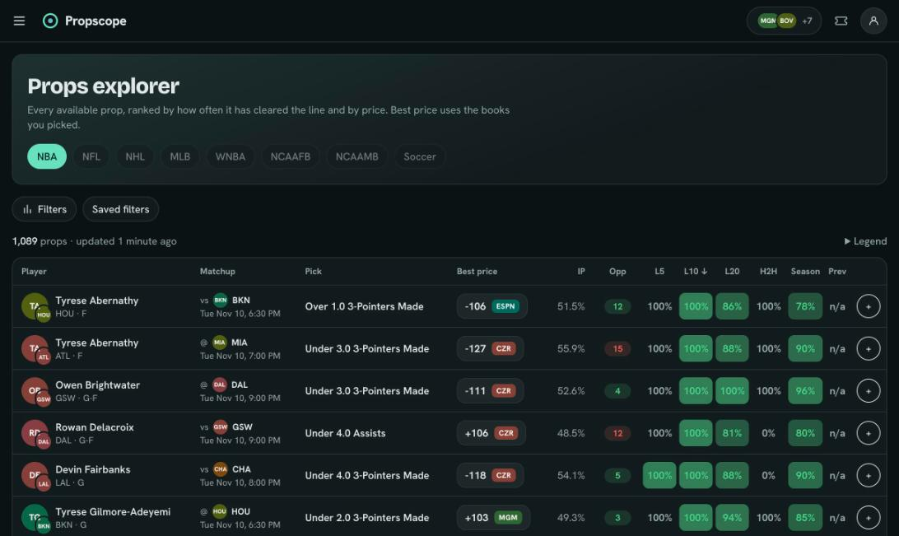
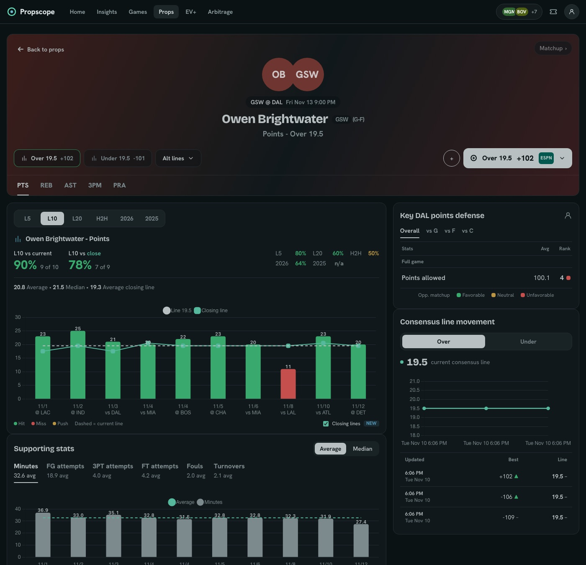
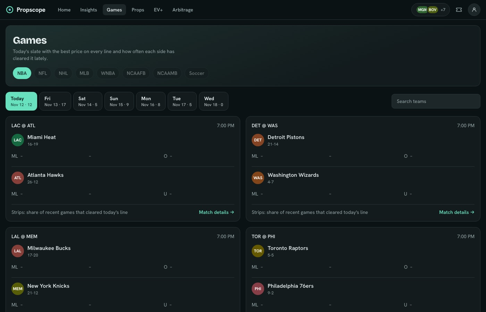
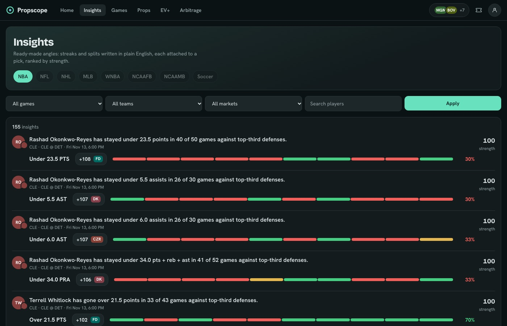
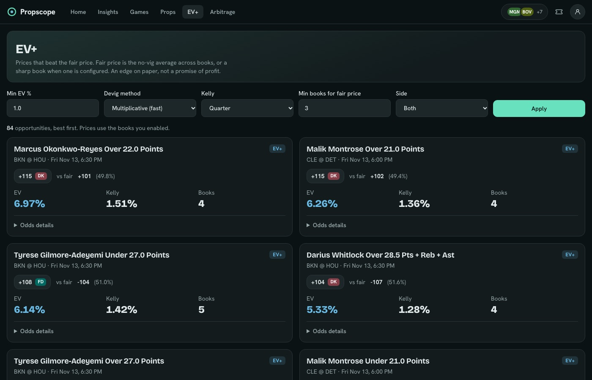

# Propscope

An open-source, self-hosted **sports betting research tool** for player props (NBA first). It answers one question: *which props have historical evidence on their side, at the best available price?*

It is a research and analytics tool. It never takes bets, never handles money and never links to funding flows. Nothing here is betting advice. If gambling is a problem for you, help is available (in the US: 1-800-GAMBLER).



## What it does
- **Props explorer:** every available prop with the best price across your chosen books, implied probability, opponent matchup, and heat-tinted hit rates (L5, L10, L20, vs this opponent, this season, last season). Filters with a live result count, sorting, saved filters, shareable URLs.
- **Prop detail:** per-game bar chart against the line, each game's closing line overlaid, supporting stats, defence vs position, same-position history against the opponent, line movement.
- **Games and game pages:** the slate with lines and hit strips; per game, odds, insights, and a matchup tab.
- **Insights:** plain-English streaks and splits attached to a pick, ranked by strength.
- **EV+ and Arbitrage:** devigged fair price (sharp book if configured, otherwise a market consensus), EV and Kelly; two-book arbitrage with whole-cent stake splits.
- **My Picks slip (parlay builder):** add legs with the +, choose a book, and see every leg at that book's price with the combined odds and payout for your stake. See which single book pays most for the whole slip. Copy it, or open a leg at the book where the provider gives a betslip link. Alternate lines included.
- **American or decimal odds**, dark and light themes, and no accounts needed: self-hosted copies are single-user by default.
- **Optional model:** a small XGBoost projection service, honestly evaluated (see `model_service/README.md`).

| | |
|---|---|
|  |  |
|  |  |

*Screenshots use the bundled synthetic sample data (fictional players).*

## Run it
```
bin/self-host          # Docker: app + Postgres + sample data, open http://localhost:3000
```
Real data needs your own API keys; see **[docs/self-hosting.md](docs/self-hosting.md)**.

## Data, API keys and terms
You bring your own keys. You are responsible for following each provider's terms.

- **[SportsGameOdds](https://sportsgameodds.com):** odds and props. The free tier (2,500 events a month) is enough; the app budgets itself to stay inside it. Its terms forbid bulk exports and redistribution, so this app only shows data in its UI and offers no export endpoint.
- **[BallDontLie](https://balldontlie.io):** teams, players, games and box scores. Box scores need a paid plan (ALL-STAR, about $9.99 a month for NBA at the time of writing).
- No scraping, no private APIs. Sportsbooks appear as text badges, never logos. Team and player icons are generated monograms (you can supply licensed images via `logo_url` / `photo_url`).
- This project is not affiliated with any sportsbook, data provider or other product.

## Architecture
Jobs fetch, pages read: a page request never calls an external API. See **[docs/architecture.md](docs/architecture.md)** for the diagram.

```
Provider adapters -> ingestion jobs -> PostgreSQL -> plain-Ruby services -> precompute jobs -> Hotwire pages
                                                                         \-> optional Python model service
```

## Design decisions
- **Plain-Ruby services, thin controllers and jobs.** One public method each, value objects with `Data.define`. Easy to test, easy to read.
- **Adapters are the only code that knows a vendor format.** A fixture provider replays recorded JSON through the same parsers, so dev and CI cost nothing and can never hit a live API.
- **Store raw payloads before parsing.** A parser bug is fixed and re-run from stored data (`data:renormalize`), with no budget spent twice.
- **Append-only odds, change-only inserts.** Line movement and closing lines fall out of simple queries.
- **Entity resolution skips rather than guesses.** An unmatched player is recorded for review, never silently attached to the wrong record.
- **No `Float` for odds, probabilities or stakes.** `BigDecimal` and integer American odds throughout; the `odds_math` gem (in `gems/`) is standalone and publishable.
- **Honest numbers.** Small samples are muted, pushes and DNPs are excluded and explained, EV is labelled an edge on paper, and the model's evaluation (including where it falls short) is documented.
- **Optional means optional.** The model service can be absent or down and nothing else changes (circuit breaker, timeouts, fail-soft job).

## Stack
Rails 8 (Hotwire, importmap), PostgreSQL, Solid Queue / Cache, Tailwind CSS 4 with daisyUI 5 (OKLCH themes), Chart.js, Faraday, RSpec, FactoryBot, WebMock/VCR, RuboCop (omakase), Brakeman, GitHub Actions. Optional: Python 3.13, FastAPI, XGBoost.

## Development
```
brew install rbenv ruby-build postgresql@17        # macOS
bundle install && bin/rails db:create db:migrate db:seed
bin/dev                                            # http://localhost:3000, sample data
bundle exec rspec && bin/rubocop && bin/brakeman   # tests and checks
cd model_service && pip install -r requirements-dev.txt && python -m pytest
```
Docs: `docs/architecture.md`, `docs/data-model.md`, `docs/operations.md`, `docs/design.md`, `docs/ev-and-arbitrage.md`, `docs/providers/`.

## Repository layout
```
app/providers   adapters, DTOs, registry, fixture provider
app/services    plain-Ruby domain services and ingestion
app/queries     the props explorer query object
app/jobs        thin jobs (see docs/operations.md)
gems/odds_math  odds conversions, devig, EV, Kelly, arbitrage (standalone gem)
model_service/  optional FastAPI + XGBoost service
legacy-next/    an archived early prototype (ignored by the build)
```

## License
MIT. See [LICENSE](LICENSE).
