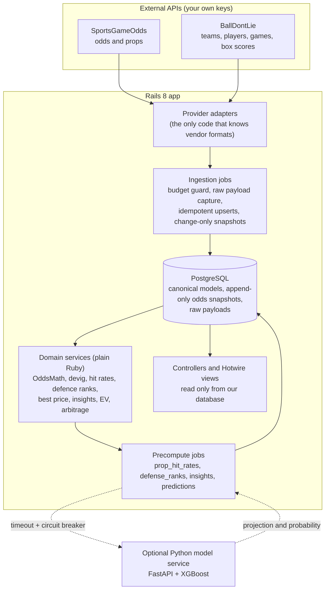

# Architecture

**Golden rule: a page request never calls an external API. Jobs fetch, pages read.**

## Data flow
1. **Adapters** (`app/providers`) turn each vendor's JSON into immutable `Data.define` DTOs. A fixture provider replays recorded JSON through the same parsers, so development and tests never spend budget.
2. **Ingestion** stores every raw response first (14 days), then upserts canonical rows. Running a job twice never duplicates anything. Odds snapshots are append-only and only inserted when a price or line changed.
3. **Entity resolution** matches odds-provider players, teams and games onto BallDontLie's canonical records (exact id, then name and team). Anything unresolved is recorded and skipped, never guessed.
4. **Services** are plain Ruby with one public method each. Money, odds and probabilities are `BigDecimal` (or integer American odds), never `Float`.
5. **Precompute jobs** fill cache tables with a `computed_at`. Pages read those tables, which is why they render in tens of milliseconds.
6. **Model service** is optional. If it is absent or down the app is unaffected (see `model_service/README.md`).

## Scheduling (US Eastern, Solid Queue `config/recurring.yml`)
06:00 reference data, 04:00 box scores, 04:30 defence ranks, 04:45 hit rates, 04:50 insights, 10:00 and 15:00 odds, every 10 minutes the odds "tick" (T-90, T-20 and tip only) and closing-line marking, 05:30 raw payload purge. Live jobs do nothing unless `LIVE_DATA=true`.

## Budget guard
`BudgetGuard` counts provider units per month. At 80% the optional snapshots (morning, afternoon, T-90) are dropped and T-20 and closing are kept. At 100% calls are refused and jobs handle it gracefully.
